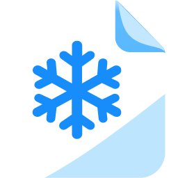

<div align="center">



# SnowPDF

**Edit, sign, and organize your PDFs without them ever leaving your computer.**

A free, 100% local PDF editor. No accounts, no cloud, no ads.


</div>

---

## Why SnowPDF

For most PDF tools you get the same two options: pay for a subscription, or upload the
document to some website you've never heard of. And those documents are often the sensitive
ones: payslips, contracts, medical reports, scanned ID cards.

SnowPDF starts from a simple idea: **your documents are yours, and they don't need to leave
your computer to get edited.**

## Philosophy

- **Local, for real.** Everything runs on your machine. The app makes no network calls at all:
  no server, no analytics, no silent update checks. It works exactly the same offline.
- **No accounts.** Install it and use it. No sign up, no login, no trial period.
- **Everything in one place.** Editing, signing, filling forms, redacting, organizing pages,
  and batch processing, all in a single app instead of juggling several tools.
- **Respects your document.** On save, SnowPDF reuses the original PDF and only changes what
  you actually touched, so forms, links, and metadata are preserved.
- **Simple and polished.** A clear, easy to use interface, built for anyone, not just people
  who already know their way around PDF internals.

## What it can do

SnowPDF isn't an endless wall of buttons: it aims to do the things people actually use, and do
them well, without leaving a single app.

- **Edits PDFs for real.** Change a paragraph while keeping the document's original font,
  instead of covering it with a box. Add text, images, or your signature.
- **Magic eraser.** Erase text or drawings and reveal the real background underneath, even if
  it isn't white, including on scanned documents.
- **Redacts without leaving a trace.** What you remove is gone from the file too, not just
  from the view.
- **Organizes pages by dragging:** reorder, rotate, duplicate, delete, or insert.
- And everything else you'd expect from a toolbox: merge, split, compress, protect, number
  pages, and more.

This is version 0.1. The goal is to gradually cover everything you do today in Acrobat,
without paying a subscription or handing your documents to a server.

### Batch tools

| | |
|---|---|
| **Merge** | Combine several PDFs and images into one document |
| **Split** | By ranges, every N pages, or by extracting the pages you pick |
| **Compress** | Shrinks the file by recompressing images and cleaning it up |
| **Protect** | Encrypts with a password (AES-256) and restricts permissions |
| **Unlock** | Removes the password from a PDF you know the password for |
| **Repair** | Recovers damaged files or ones that won't open properly |
| **Flatten** | Turns forms and annotations into fixed content |
| **Rotate** and **Crop** | Rotate pages or adjust their margins |
| **Watermark** | Stamps text or an image across the pages |
| **Page numbers** | Numbers, headers, or footers |
| **Metadata** | View and edit title, author, subject, and keywords |
| **Images to/from PDF** | Turns JPG and PNG into a PDF, or each page into an image |

Keyboard shortcuts are in [docs/SHORTCUTS.md](docs/SHORTCUTS.md).

## Installation

SnowPDF is available for **Windows 10 and 11**. Download the installer, run it, done.
After that, you can open your `.pdf` files with SnowPDF straight from File Explorer.

Windows only for now: macOS and mobile (Android and iOS) are coming later. See the roadmap
below.

## Roadmap

SnowPDF is in its early versions. Next up:

- **OCR**, to search and copy text in scanned documents
- **Certificate based digital signatures**, including government eID and national certificates
- **Standard comments and annotations**, editable in any other PDF reader
- **Compare PDFs** and **PDF to text**
- **PDF/A** for government and official paperwork
- **macOS, Linux**, and later **Android and iOS**

Full detail is in [docs/ALTERNATIVES.md](docs/ALTERNATIVES.md).

## How it's built

SnowPDF is a [Tauri 2](https://tauri.app) app with a React, TypeScript, and Tailwind interface.
It uses three open source PDF engines, each for what it does best:

- **[pdf.js](https://github.com/mozilla/pdf.js)** to display pages, select, and search text
- **[pdf-lib](https://github.com/cantoo-scribe/pdf-lib)** to compose the final PDF, draw what
  you add, and encrypt
- **[MuPDF](https://mupdf.com)** (WebAssembly) to redact, compress, repair, and unlock

### Building from source

You'll need **Node.js 22+**, **Rust** (MSVC toolchain, installed via
[rustup](https://rustup.rs)), and **Visual Studio Build Tools** with the "Desktop development
with C++" workload.

```bash
npm install
npm run app:dev      # opens the desktop app in development mode
npm run dev          # or the web version at http://localhost:1420
npm test             # tests
npm run app:build    # installer in src-tauri/target/release/bundle/nsis/
```

Architecture, the document model, and code conventions are in
[docs/ARCHITECTURE.md](docs/ARCHITECTURE.md).

## Third party licenses

| Component | License |
|---|---|
| MuPDF | AGPL-3.0 |
| pdf.js | Apache-2.0 |
| pdf-lib (fork `@cantoo/pdf-lib`) | MIT |
| Tauri | MIT / Apache-2.0 |
